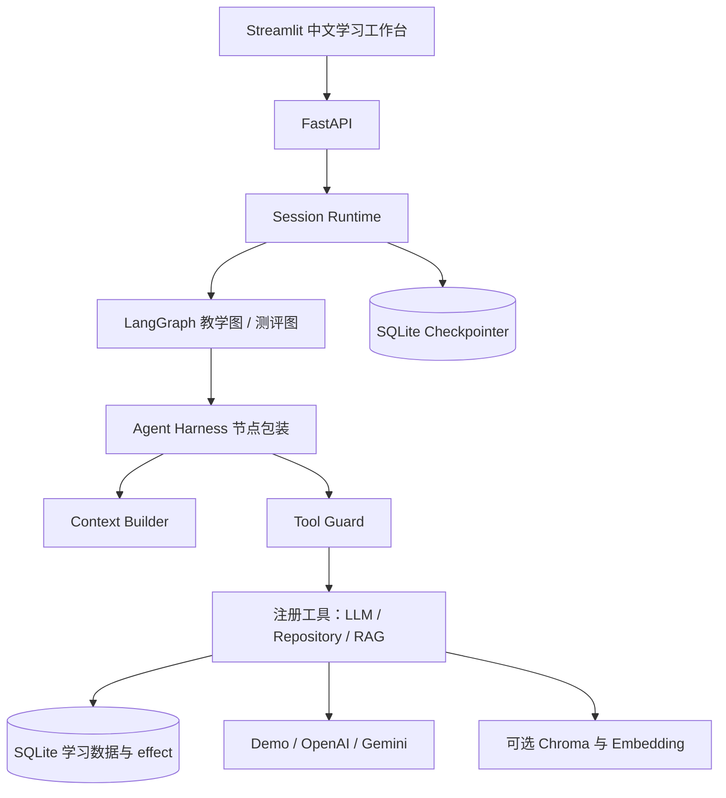

# CodeMentor｜AI 个性化编程学习助手

基于 **LangGraph + Agent Harness** 的 Python 编程学习项目：把讲解、练习、评分、学习记忆和下一步建议串成一次可追踪的学习过程。提供简体中文 Streamlit 工作台与 FastAPI 接口。

初学者常常遇到三个问题：讲解与练习脱节、历史问题难以复习、下一步学什么缺乏依据。CodeMentor 将这些环节接入同一份持久学习画像，并通过上下文预算、工具调用约束与运行检查点管理 Agent 执行。

项目基于 MIT 许可的 [EduAgent](https://github.com/Varsha-art126/EduAgent) 扩展；上游基线为 `99ae1a3ea390acd202f8873a3608fab79ca0f6e3`。保留原作者版权与来源，详见 [LICENSE](LICENSE) 和 [第三方说明](THIRD_PARTY_NOTICES.md)。

## 当前功能

| 功能 | 已实现行为 |
| --- | --- |
| 中文学习工作台 | 学习首页、AI 辅导、专项练习、学习画像、学习资料五页；中文空状态、错误提示和代码展示。 |
| 六个编程主题 | Python 基础、递归、链表、二叉树、深度优先搜索、动态规划；内部主题 ID 保持原协议。 |
| 讲解与测验 | 结构化讲解；5 道选择题、2 道数值题、1 道主观题；网页直接作答及逐题反馈。 |
| 学习画像 | 实际测验总数、最近 50 次得分、当前薄弱知识点、已讲解主题与学习建议。 |
| Context Builder | 按学生与主题从 SQL 筛选画像、近期记录和错题，在 token 预算内形成实际 Agent Prompt 上下文。 |
| Tool Guard | 对注册工具执行节点权限、参数、归属、调用次数、重复调用和超时检查；本地写入通过 effect 记录去重。 |
| Session Runtime | session/run 标识、请求冲突检查、持久检查点、暂停/恢复、已完成结果重放。 |
| 可选文档检索 | 继承 TXT/Markdown/PDF 入库与检索能力；只有后端启用时才开放资料管理。轻量 Demo 默认关闭。 |

## 架构



完整图路由、职责及限制见 [docs/architecture.md](docs/architecture.md)。

## 快速开始：无需模型密钥

使用 Python **3.13**，获取源码后进入项目根目录：

```bash
git clone https://github.com/uplaybiss/CodeMentor.git
cd CodeMentor
```

**Windows PowerShell：**

```powershell
py -3.13 -m venv .venv
.\.venv\Scripts\python.exe -X utf8 -m pip install -r requirements-local.txt -r requirements-frontend.txt -c requirements-verified.txt
$env:TIKTOKEN_CACHE_DIR = Join-Path (Get-Location) 'demo/token_cache'
.\.venv\Scripts\python.exe -X utf8 -c "import tiktoken; tiktoken.get_encoding('cl100k_base')"
if (-not (Test-Path -LiteralPath '.env')) { Copy-Item .env.example .env }
```

如果已有 `.env`，保留它并只补充需要的配置，不要覆盖已有密钥。复制样例对 Demo 不是必需步骤。安装清单固定直接依赖，`requirements-verified.txt` 约束本轮验证的传递依赖版本。

**终端一，API：**

```powershell
.\.venv\Scripts\python.exe -X utf8 -m demo.local --port 8013
```

**终端二，学生界面：**

```powershell
$env:FRONTEND_API_BASE_URL = "http://127.0.0.1:8013"
.\.venv\Scripts\python.exe -X utf8 -m streamlit run frontend/app.py --server.fileWatcherType none --server.port 8501
```

**Linux / macOS：**

```bash
python3.13 -m venv .venv
.venv/bin/python -m pip install -r requirements-local.txt -r requirements-frontend.txt -c requirements-verified.txt
TIKTOKEN_CACHE_DIR="$PWD/demo/token_cache" .venv/bin/python -c "import tiktoken; tiktoken.get_encoding('cl100k_base')"
cp -n .env.example .env
.venv/bin/python -m demo.local --port 8013
# 另一个终端
FRONTEND_API_BASE_URL=http://127.0.0.1:8013 .venv/bin/python -m streamlit run frontend/app.py --server.fileWatcherType none --server.port 8501
```

- 学生使用：**http://localhost:8501**。
- 开发者接口文档：**http://localhost:8013/docs**。
- 健康检查：**http://localhost:8013/health**。

首次进入后选择“递归” → 阅读讲解 → 进入专项练习 → 提交答案 → 查看学习画像。所有统计来自 API；尚无历史时显示引导。停止服务时在对应终端按 `Ctrl+C`。

## 演示模式与真实模型

`demo.local` 强制选择固定 Demo Provider、关闭 RAG，使用 `data/local_demo/` 中的业务数据库与检查点。它不调用付费模型，也不下载 Embedding 权重。安装阶段的 tiktoken 命令从官方源下载并校验固定分词词表，准备后可离线计数；词表缓存不随源码分发。固定题库覆盖六个主题，每主题 8 道不同题干。

客观题按完整选项或数值容差评分；Demo 的非空主观题固定得分为该题分值的 80%，空答案为 0。Demo 流程与测试通过不代表真实教学效果、模型准确率或线上性能；没有注册用户量、吞吐量或效果提升等项目指标。

已有 OpenAI / Gemini Provider 通过 `LLM_PROVIDER`、对应 `LLM_*_API_KEY` 与 `LLM_*_MODEL` 配置。真实模型模式使用普通 `api.main:app` 入口，不能用会强制 Demo 的启动器。密钥只放本地忽略文件或部署平台 Secret，真实模型路径本轮未调用。详见 [部署说明](docs/deployment.md)。

RAG 完整依赖在 `requirements.txt`；安装可能下载模型运行库。PDF 解析依赖 PyMuPDF，其 AGPL/商业双许可需要单独处理，不能将项目 MIT 声明理解为所有依赖均为 MIT。见 [第三方说明](THIRD_PARTY_NOTICES.md)。

## 测试与 CI

```powershell
.\.venv\Scripts\python.exe -X utf8 -m pip install -r requirements-test-local.txt -r requirements-frontend.txt -c requirements-verified.txt
$env:ANONYMIZED_TELEMETRY = 'False'
$env:HF_HUB_OFFLINE = '1'
$env:LANGSMITH_TRACING = 'false'
$env:LANGCHAIN_TRACING_V2 = 'false'
$env:TIKTOKEN_CACHE_DIR = Join-Path (Get-Location) 'demo/token_cache'
.\.venv\Scripts\python.exe -X utf8 -c "import tiktoken; tiktoken.get_encoding('cl100k_base')"
.\.venv\Scripts\python.exe -X utf8 -m pytest tests
.\.venv\Scripts\python.exe -X utf8 -m pip check
```

测试使用临时数据库、Demo Provider 和 FakeEmbedder，覆盖真实图执行、上下文预算、工具约束、恢复/重放及前端组件。CI 配置在 [.github/workflows/ci.yml](.github/workflows/ci.yml)，在 push 与 Pull Request 时运行 Windows / Ubuntu 的同一套离线模型测试。每次远程执行结果以 [GitHub Actions](https://github.com/uplaybiss/CodeMentor/actions/workflows/ci.yml) 为准；本地验证记录见 [docs/testing.md](docs/testing.md)。

## 目录与进一步文档

```text
agents/          教学、练习、测评、记忆、推荐与检索节点
api/             FastAPI 路由与依赖注入
config/          类型化配置、课程规则、中文显示映射
database/        SQLite / SQLAlchemy 模型与 Repository
demo/            无密钥启动器与验收脚本
frontend/        Streamlit 工作台、HTTP 客户端与 UI 会话
graphs/          两个 LangGraph 工作流
harness/         Context Builder / Tool Guard / Session Runtime
models/          Pydantic 协议与图状态
prompts/         中文自然语言要求与结构化输出约束
services/        Provider、RAG 与 Container
tests/           自动化回归与组件测试
evaluation/      上游评估脚本；生成结果不作为本项目效果指标
experiments/     上游分块实验脚本；生成结果不随候选发布
docs/            架构、部署、测试、安全与依赖许可说明
```

查看 [Windows 前端指南](README_FRONTEND_ZH.md)、[开源安全报告](docs/security-audit.md) 和 [依赖许可清单](docs/dependency-licenses.md)。

## 当前使用边界

这是本地学习与 Agent 工程示例。学习档案名称不是登录；学生 ID 是查询/隔离键，文档语料和部分读取接口不构成完整多租户权限系统。当前 SQLite 与进程内运行锁适合单 API 进程，写入超时是软截止，不能强行终止已在执行的同步写入。

当前没有生产身份认证、计费、部署平台适配或公开演示站。测试部署先采用受访问控制的单实例 Demo；不要把真实学习记录或付费模型服务直接暴露到公网。部署限制与数据持久化方案见 [docs/deployment.md](docs/deployment.md)。
