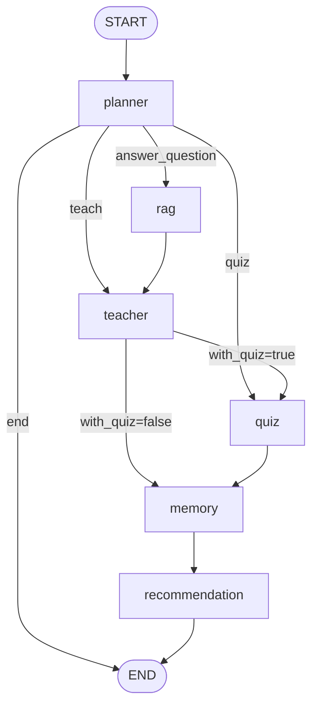
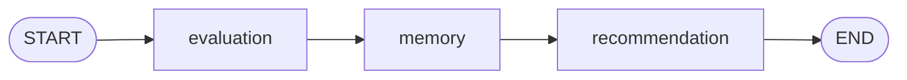

# CodeMentor 架构与执行边界

本说明以当前源码为准；公开准备阶段不修改教学图、测评图、Agent 或 Harness 的业务行为。

## 分层与依赖

| 层 | 源码入口 | 责任 |
| --- | --- | --- |
| 中文界面 | `frontend/app.py`、`session.py`、`api_client.py` | 五页学习路径、UI 会话、真实 HTTP 请求与重试。 |
| HTTP API | `api/main.py`、`api/routers/` | 请求校验、依赖注入、状态/恢复/评分及只读统计。 |
| 组装 | `services/container.py` | 构造 Repository、Provider、可选 RAG、Harness、Runtime。 |
| 图调度 | `graphs/workflow.py` | 两个 StateGraph，决定节点之间的先后与条件边。 |
| Agent | `agents/` | Planner、Teacher、Quiz、Evaluation、Memory、Recommendation、RAG。 |
| 执行约束 | `harness/` | 节点上下文、受控工具执行、run 状态与检查点。 |
| 数据 | `database/`、`models/` | SQLAlchemy 持久化、Pydantic Schema、图状态与运行/副作用记录。 |
| 内容与策略 | `prompts/`、`config/curriculum.py` | 中文自然语言要求、结构化输出、主题/先修/推荐规则。 |

## 教学图

Planner 根据分类结果计算 `next_agent`，LangGraph 使用明确的条件映射路由。模型可生成主题/学习目标，但不能任意选择未注册节点。Teacher 可串接 Quiz；一般结束分支直接终止，不保证每条闲聊都会经过记忆/推荐尾部。

## 测评图

Evaluation 校验题目 ID，选择题比较完整选项文本，数值题采用容差。主观题由 Provider 返回 0–1 分值；总分由 Python 计算。Demo 的非空主观题固定为 0.8。评分、错题、掌握度、成绩与进度仍经原注册写工具持久化；推荐沿用原课程策略。

## Harness 三个关键部分

### Context Builder

`harness/context_builder.py` 按 student/topic 查询画像、主题掌握度、近期相关对话、长期记忆和错题。先在 SQL 层过滤/限制记录，再按优先级删减内容，以 `cl100k_base` 精确计数上下文 JSON。

默认 `HARNESS_CONTEXT_TOKENS=512` 限制的是注入上下文载荷，不是完整系统提示、模型总上下文窗口或 API 计费 token。不能将该计数解释为真实模型费用或性能收益。超过预算且不能继续裁剪时，抛出明确的预算错误。

### Tool Guard

`harness/tools.py` 注册工具与节点权限；`harness/tool_guard.py` 处理实际 dispatch：校验工具名、节点权限、Pydantic 参数、学生归属、调用次数、重复签名和超时，并保留运行事件。

只读工具按设定执行有限重试；本地同步写工具将业务写入与 `HarnessEffect` 记录放在同一数据库事务，重复 effect 返回缓存结果。计数单位是注册工具的 dispatch 尝试，包含重试，不是底层 SQL 数量或 Provider SDK 的网络重试数量。

写入截止时间是软限制；不能据此声称已经中止运行中的线程、外部 API 或实现分布式 exactly-once。当前机制针对本地数据库副作用。

### Session Runtime

`harness/session_runtime.py` 用 student/session/run/workflow 元组生成 thread 身份，将请求哈希、状态、结果与持久调用预算保存在业务库，使用 `AsyncSqliteSaver` 保存图检查点。

- 新 run 执行教学图或测评图；同 ID 不同请求返回冲突。
- 同一已完成 run 重放结果，不再新增业务写入。
- 受支持节点可暂停；恢复从已有检查点继续。
- 自动测验提交身份由学生、测验和答案形成；显式新 run 代表有意重新尝试。
- 锁是进程内 `asyncio.Lock`，当前测试部署使用单 API 进程。

`harness/agent_harness.py` 将节点包装、Context Builder 与 Tool Guard 串起来；LangGraph 仍负责流程控制，Runtime 负责一次流程的生命周期，不另建一套教学调度算法。

## 前端标识、重试与画像

同一界面会话保持 session，新的主动消息生成新的 run。网络失败后先查询原 run，再继续或重发同一请求。评分首次提交后保留答案，成功结果缓存在 UI 会话，rerun 不重新 POST。

清空界面只改变临时聊天状态，数据库历史保留。整页刷新会重置当前聊天/活动测验，历史成绩仍可从 API 读取。档案名映射到本地稳定 ID，但不提供登录或身份认证。

dashboard 的总数统计所有作答，曲线只取最近 50 次；当前弱项来自最新 ConceptScore 的 `<0.6`，而本次错题反馈只描述该测验。完成讲解的主题不等于已经掌握。

## RAG 与部署限制

完整路径提供文档提取、分块、Embedding、Chroma 检索及来源；轻量 Demo 将它关闭，前端据 `/health.rag_enabled` 隐藏上传。测试启用分支使用 FakeEmbedder，不代表真实模型检索质量已验证。

学生 ID 不是鉴权。文档共享语料及部分读取接口没有生产多租户隔离，不能直接承载公网真实用户。详见 [deployment.md](deployment.md) 与 [security-audit.md](security-audit.md)。
