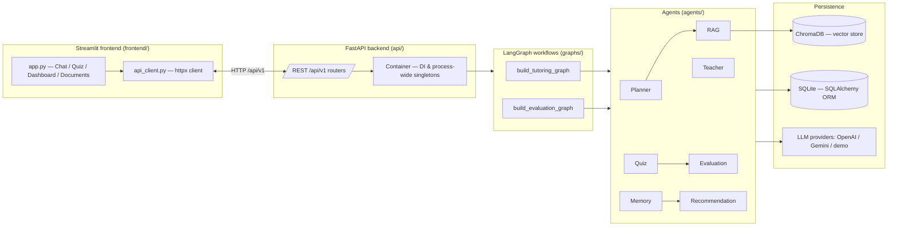
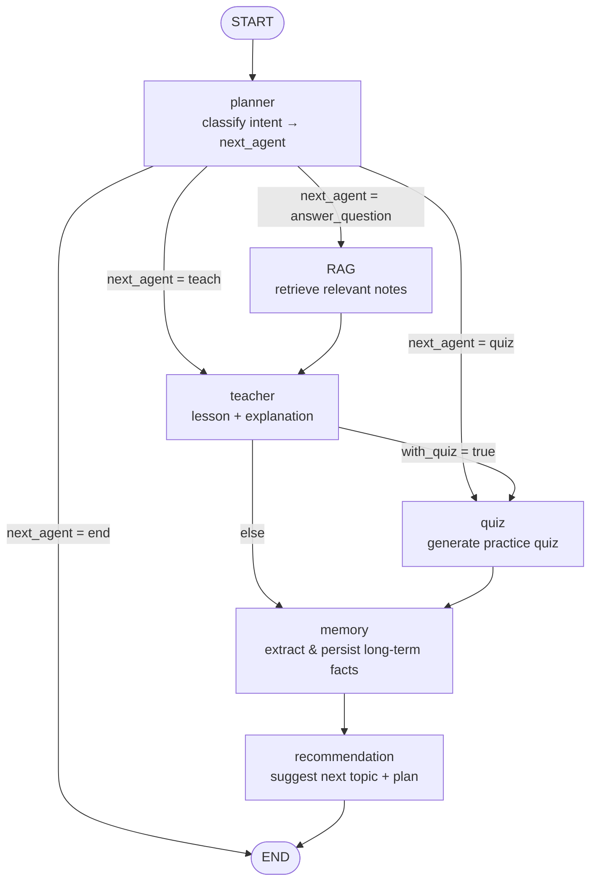
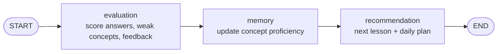
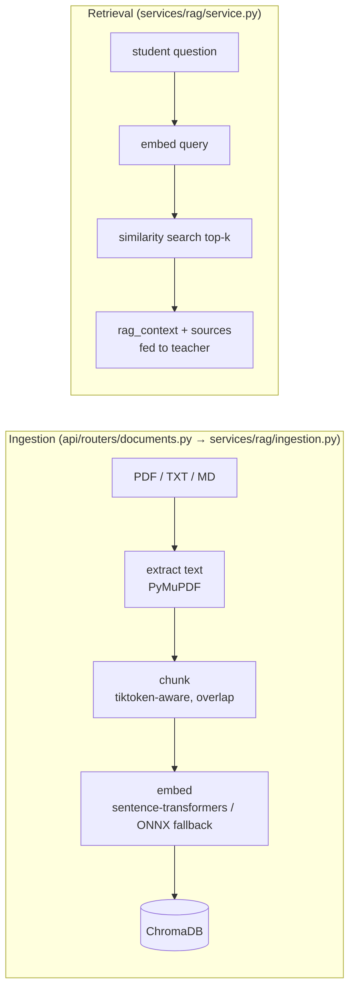
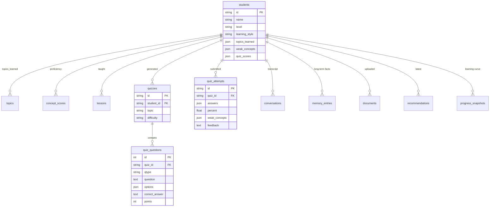
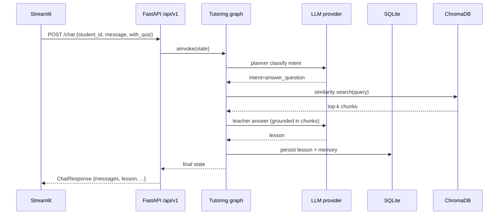
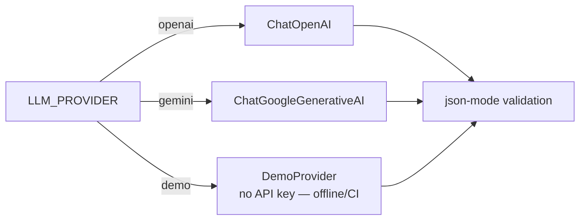

# EduAgent — Architecture

This document describes the system architecture of EduAgent. All diagrams are
[Mermaid](https://mermaid.js.org/) and render on GitHub; they can also be edited
in any Mermaid-aware editor.

---

## 1. System context

**Layers**

| Layer | Path | Responsibility |
|---|---|---|
| Presentation | `frontend/` | Streamlit UI, session state, httpx API client |
| API | `api/` | REST routers, Pydantic request/response models, DI |
| Orchestration | `graphs/` | Compiled LangGraph state machines |
| Agents | `agents/` | One node per agent; structured LLM I/O via `AgentContext` |
| Domain | `models/` | Pydantic schemas, enums, LangGraph state `TypedDict` |
| Services | `services/` | LLM client, RAG (chunk → embed → retrieve), DI container |
| Persistence | `database/` | SQLAlchemy ORM models, repositories, connection/session mgmt |
| Config | `config/` | pydantic-settings models (env-driven), constants, prompt loader |
| Utils | `utils/` | Logging, error types, dependency-free helpers |

---

## 2. Tutoring workflow (chat turn)

Every `/api/v1/chat` call runs the tutoring graph. The **planner** classifies
the student's intent and emits a deterministic `next_agent` value that drives a
conditional edge — routing stays out of the LLM's hands.

### Intent routing

| Planner intent | Route | Chain |
|---|---|---|
| `learn` | `teach` | teacher → (quiz if `with_quiz`) → memory → recommendation |
| `answer_question` | `answer_question` | rag → teacher → memory → recommendation |
| `practice` | `quiz` | quiz → memory → recommendation |
| unclassified / end | `end` | terminate |

---

## 3. Evaluation workflow (quiz submission)

`/api/v1/chat/submit-quiz` runs a shorter linear graph that grades the answers,
persists the attempt, updates memory and issues the next recommendation.

---

## 4. RAG pipeline

Documents are ingested once; retrieval happens on every `answer_question` turn.

Notes:

* Chunking is token-aware when `tiktoken` is available, with a word-based
  fallback.
* Embeddings default to local `sentence-transformers` (no API key); a
  deterministic trigram-hash embedder exists for tests.
* Re-ingesting a `doc_id` replaces its prior chunks; deleting a document also
  clears its vectors.

---

## 5. Data model (SQLite)

All tables reference `students.id`; list-valued columns use SQLite `JSON`.

### Repository ↔ table mapping

| Repository | Tables |
|---|---|
| `StudentRepository` | `students`, `topics`, `concept_scores` |
| `QuizRepository` | `quizzes`, `quiz_questions`, `quiz_attempts` |
| `LessonRepository` | `lessons` |
| `MemoryRepository` | `memory_entries`, `recommendations` |
| `ConversationRepository` | `conversations` |
| `DocumentRepository` | `documents` |
| `ProgressRepository` | `progress_snapshots` |

---

## 6. Chat request sequence

---

## 7. LLM provider selection

Providers are constructed **lazily** — the app boots with no API keys, and a
missing/invalid provider raises `ProviderConfigurationError` only when a model
is first requested. `demo` makes the whole stack runnable offline and in CI.
